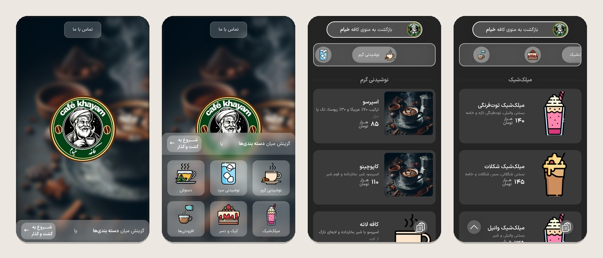

# Khayam Café — Mobile Digital Menu

A mobile-first, right-to-left (Persian) digital menu for a café, built with React and Vite.
Guests browse categories and scroll through the menu while a sticky category bar keeps up with them.

This was a client project for Khayam Café in 2024 and ran live for several months.



> The café's back end is no longer online, so these screenshots were taken with sample menu data.

## My role

I built the front end in this repository. A teammate built the REST API and the admin panel in ASP.NET Core; that code lives in a separate repository.

## Features

- **Category home page.** A grid of menu categories; tapping one opens the menu already scrolled to that category.
- **Virtualized menu.** Categories and their items are rendered as one virtualized list (`react-window` `VariableSizeList`), with different row heights for category headers and item cards, so long menus stay smooth on phones.
- **Two-way synced category bar.** A sticky [Swiper](https://swiperjs.com/) bar follows the scroll position: scrolling the list moves the bar to the visible category, and tapping or swiping the bar scrolls the list to that section. Guard flags stop the two directions from triggering each other, and the scroll handler is throttled.
- **Scroll-to-top button** that appears once the guest scrolls down the menu.
- **Loading states** while menu data is fetched.
- **RTL Persian UI** with the IRANSans font, a glass-style dark theme, and Swiper breakpoints from 320 px phones to 1440 px screens.
- **Persian 404 page** for unknown routes.

## Tech stack

React 18 · Vite 5 · React Router 6 · Context API · axios · react-window · Swiper · Sass (SCSS) · Bootstrap 5 · Font Awesome

## How it works

1. On start-up, `App.jsx` fetches all categories, then the items of each category, from the REST API with axios.
2. The results are flattened into one ordered array — `[category, …its items, category, …its items]` — and shared through React Context.
3. The menu page renders that array with `VariableSizeList`. A row without a `price` is a category header (50 px); any other row is an item card (180 px).
4. `onItemsRendered` reports which rows are visible, and the Swiper bar slides to the matching category. Going the other way, a tap on the bar calls `scrollToItem` on the list.

## Getting started

```bash
npm install
npm run dev
```

Then open <http://localhost:5173/Mobile-Restaurant-Menu/>.

The app expects the café's API at the address set in `SERVER_URL` (`src/services/apiServices/GetRequests.jsx`):

| Endpoint | Returns |
| --- | --- |
| `GET /api/category/GetAllCategories` | `{ content: [{ id, name, picturePath }] }` |
| `GET /api/Products/GetProductsByCaterory?categoryId={id}` | `{ content: [{ id, name, description, price, picturePath }] }` |

Endpoint names are as the back end defined them. Other scripts: `npm run build`, `npm run preview`, `npm run lint`.

## Project structure

```
src/
├── App.jsx                     # data loading + Context provider
├── routes.jsx                  # home, menu (/products), contact, 404
├── Context/AppContext.jsx      # shared menu state
├── services/apiServices/       # axios API calls
├── helpers/photos.jsx          # static image imports
└── components/
    ├── HomePage/  Layout/      # home page: logo, background, category grid
    ├── Products/               # virtualized menu + synced category bar
    ├── Contact-us/             # contact page
    ├── Modal/  Loading/        # shared UI
    └── index.jsx               # component exports
```

## Status

This is an archived client project and is not maintained. A search page, product details popup and order notes were planned but not finished.

## Author

**Abolfazl Abbaspour** — Front-End Developer
[Portfolio](https://abolfazlabbaspour.vercel.app) · [LinkedIn](https://www.linkedin.com/in/abolfazlabbaspour) · [GitHub](https://github.com/iabolfazl83)
